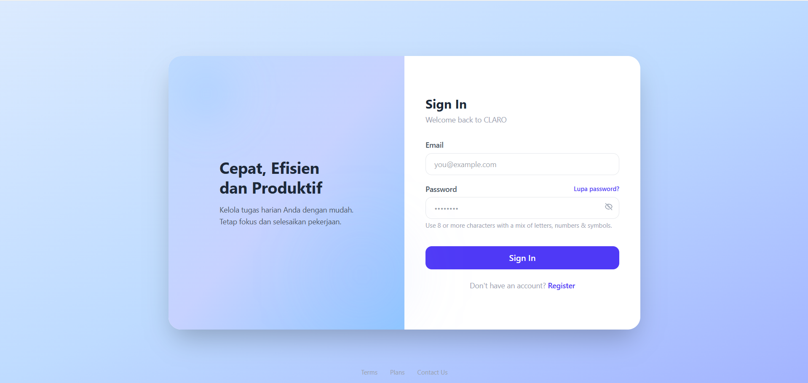
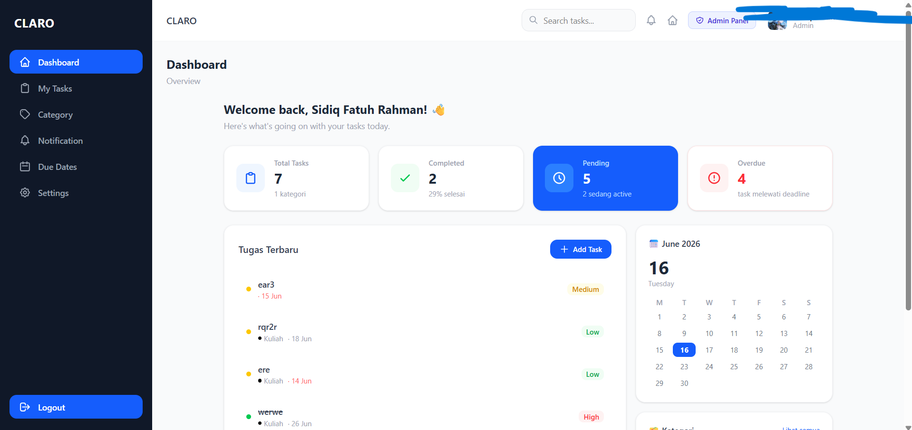

# Wassup Task — Todo App dengan Reminder Otomatis ke WhatsApp

**Wassup Task** adalah aplikasi manajemen tugas (to-do list) berbasis web yang mengirim **pengingat deadline otomatis ke WhatsApp** pengguna menggunakan **Fonnte API**. Dibangun dengan Laravel 13, Tailwind CSS v4, dan MySQL, seluruh stack dijalankan dalam Docker sehingga bisa langsung `docker compose up -d` tanpa instalasi manual PHP/Node/MySQL di mesin lokal.


[](https://github.com/SidiqFatuh187/TodoAPP-Docker/actions/workflows/ci.yml)
[](https://github.com/SidiqFatuh187/TodoAPP-Docker/actions/workflows/cd.yml)

> 💡 Proyek ini dibuat sebagai referensi belajar (Laravel + Docker + integrasi WhatsApp/email API). Bebas dipakai, dipelajari, di-*fork*, atau dikembangkan lebih lanjut — kontribusi lewat Pull Request juga sangat terbuka. Lihat bagian [Kontribusi](#-kontribusi).

---

## 📋 Daftar Isi

- [Tentang Proyek](#-tentang-proyek)
- [Tampilan Aplikasi](#-tampilan-aplikasi)
- [Fitur Utama](#-fitur-utama)
- [Cara Kerja Reminder WhatsApp](#-cara-kerja-reminder-whatsapp)
- [Tech Stack](#-tech-stack)
- [Arsitektur Docker](#-arsitektur-docker)
- [Struktur Proyek](#-struktur-proyek)
- [Instalasi & Menjalankan](#-instalasi--menjalankan)
- [Environment Variables Penting](#-environment-variables-penting)
- [Menjalankan Scheduler (Reminder)](#-menjalankan-scheduler-reminder)
- [Testing & CI/CD](#-testing--cicd)
- [Roadmap](#-roadmap)
- [Kontribusi](#-kontribusi)
- [Lisensi](#-lisensi)

---

## 📌 Tentang Proyek

**Wassup Task** membantu pengguna mencatat tugas lengkap dengan kategori, prioritas, dan deadline, lalu secara otomatis **mengingatkan lewat WhatsApp** setiap ada tugas yang mendekati atau melewati deadline — tanpa perlu buka aplikasi. Cocok untuk kebutuhan personal task management yang notifikasinya ingin langsung sampai di HP, bukan cuma badge notifikasi di web.

Aplikasi ini juga dilengkapi panel admin, reset password via OTP (email), dan pencatatan aktivitas (activity log) untuk keperluan audit.

## 🖼️ Tampilan Aplikasi

| Halaman Login | Dashboard |
|---|---|
|  |  |

- **Sign In** — halaman login dengan email & password, plus link *Lupa password* (reset via OTP email) dan link ke halaman Register.
- **Dashboard** — ringkasan Total Tasks, Completed, Pending, dan Overdue, daftar tugas terbaru, kalender bulan berjalan, serta akses cepat ke Admin Panel bagi user dengan role admin.

## ✨ Fitur Utama

### 🗂️ Manajemen Tugas (Todo)
- CRUD tugas lengkap: judul, deskripsi, kategori, prioritas (`low` / `medium` / `high`), status (`pending` / `active` / `completed`), dan deadline
- Lampiran file per tugas (pdf, doc, docx, xls, xlsx, jpg, png, maks. 5 MB) disimpan privat dengan nama acak; unduhan memeriksa pemilik tugas dan file dihapus saat tugas dihapus
- Pencarian & filter tugas berdasarkan status, kategori, atau kata kunci (termasuk quick search via AJAX)
- Kategori kustom dengan warna & ikon per user
- Halaman **Due Dates** yang mengelompokkan tugas ke: **Terlambat**, **Hari Ini**, **Besok**, dan **Nanti**

### 📲 Smart Reminder Otomatis ke WhatsApp (Fonnte)
- Sistem pengingat bertahap multi-level:
  - 🌅 **Rangkuman Pagi (*Morning Digest*)**: Ringkasan terpadu tugas hari ini dan besok antara jam 07:00 – 09:00 pagi (anti-spam, 1 pesan untuk semua tugas).
  - ⏳ **Pengingat Awal H-3**: Pengingat dini 3 hari sebelum deadline (mulai jam 09:00 pagi) untuk tugas besar atau laporan praktikum.
  - ⏰ **Pengingat H-1**: Notifikasi mulai jam 17:00 waktu lokal pengguna.
  - ⚠️ **Peringatan Kritis (*Urgent*)**: Alarm darurat saat sisa waktu $< 6$ jam dan $< 1$ jam sebelum deadline.
  - 🚨 **Tugas Terlambat (*Overdue*)**: Peringatan saat batas waktu tugas telah terlewati.
- Pesan WhatsApp berformat rapi dan informatif (nama user, judul tugas, prioritas dengan ikon warna, jam deadline).
- Mendukung WIB, WITA, dan WIT per pengguna. Input dan tampilan mengikuti zona pengguna; penyimpanan memakai `Asia/Jakarta`.
- Pencegahan pengiriman ulang memakai tabel `reminder_deliveries` yang terpisah dari inbox. Batas duplikasi pada kegagalan koneksi penyedia dijelaskan di bagian cara kerja.
- Notifikasi terintegrasi ganda: tersimpan di database (in-app notification center) dan dikirim ke WhatsApp pengguna.

### 💬 Interaksi WhatsApp Dua Arah (Incoming Webhook)
Pengguna bisa mengontrol tugas langsung dari chat WhatsApp tanpa membuka website:
- **`DONE <id>`** atau **`SELESAI <id>`**: Menandai tugas selesai secara instan.
- **`TUNDA <id> <durasi>`**: Mengundur deadline tugas (contoh: `TUNDA 12 2h`, `TUNDA 12 1d`).
- **`HAPUS <id>`** atau **`DEL <id>`**: Menghapus tugas dari sistem langsung dari WhatsApp.
- **`CARI <kata kunci>`**: Mencari tugas aktif atau riwayat berdasarkan kata kunci.
- **`REKAP`** atau **`SUMMARY`**: Menampilkan ringkasan progres tugas hari ini (selesai vs pending).
- **`TODO <judul>`**: Mencatat tugas baru cepat dengan deteksi otomatis deadline, jam, kategori, dan prioritas.
- **`TUGAS`** atau **`LIST`**: Menampilkan daftar tugas aktif beserta deadline dan ID-nya.
- **`HELP`** atau **`BANTUAN`**: Menampilkan petunjuk format perintah lengkap.

### 🔐 Autentikasi & Keamanan
- Register, Login, Logout
- Reset password via **kode OTP yang dikirim ke email** (menggunakan Resend API)
- Middleware pengecekan akun yang di-banned (`CheckBanned`)
- Artisan command & Seeder pembuatan admin: `php artisan app:create-admin`

### 🔔 Notifikasi In-App
- Pusat notifikasi (list, tandai semua terbaca, hapus satu/semua)

### 👤 Profil & Pengaturan
- Edit profil (nama, no. HP, bio, avatar), ganti password
- Notifikasi sambutan otomatis saat pertama kali menghubungkan no HP WhatsApp
- Pengaturan zona waktu (WIB/WITA/WIT) yang memengaruhi jadwal reminder

### 🛠️ Panel Admin
- Dashboard ringkasan (jumlah user, tugas, user baru minggu ini, dll.)
- Kelola pengguna (ban / unban)
- Kelola seluruh tugas & kategori semua user
- Activity log (lihat & hapus log aktivitas user)
- Export data user ke CSV

### 🧾 Activity Logging
- Pencatatan aktivitas otomatis lewat Laravel event listener (`LogTaskActivity`, `LogUserActivity`) untuk jejak audit

## ⏰ Cara Kerja Reminder WhatsApp

Inti fitur reminder ada di command `app:send-task-notifications`, dijadwalkan berjalan **setiap 15 menit** melalui Laravel Scheduler:

```php
// routes/console.php
Schedule::command('app:send-task-notifications --timezone=Asia/Jakarta')
    ->everyFifteenMinutes()
    ->timezone('Asia/Jakarta');
```

Setiap kali dijalankan, scheduler mengecek batas waktu tugas dan mengirimkan notifikasi sesuai fase pengingat:

| Tahap Pengingat | Waktu / Kondisi | Notification Class | Tujuan & Karakteristik |
|---|---|---|---|
| 🌅 **Morning Digest** | Jam 07:00 – 09:00 pagi | `MorningDigestNotification` | Merangkum semua tugas hari ini & besok dalam 1 pesan WA agar anti-spam |
| ⏳ **Early Warning (H-3)** | 3 hari sebelum deadline (mulai jam 09:00 pagi) | `TaskH3Reminder` | Peringatan awal untuk tugas besar / kelompok yang butuh waktu lama |
| ⏰ **Warning (H-1)** | 1 hari sebelum deadline (mulai jam 17:00 sore) | `TaskDeadlineReminder` | Mengingatkan tugas besok agar pengguna mulai mencicil malam itu |
| ⚠️ **Urgent Warning** | Sisa waktu $< 6$ jam & $< 1$ jam sebelum deadline | `TaskUrgentReminder` | Alarm darurat bagi yang suka SKS atau lupa menekan tombol submit |
| 🚨 **Overdue** | Deadline telah lewat (sesuai timezone user) | `TaskOverdue` | Memberitahu tugas yang telah melewati batas waktu pengumpulan |

Alur pengirimannya:
1. Command menghitung jadwal berdasarkan zona waktu pengguna; timestamp disimpan dalam zona kanonis `Asia/Jakarta`.
2. Tabel `reminder_deliveries` menyimpan identitas unik pengguna, tugas, jenis pengingat, urgency, dan deadline. Morning digest menggunakan tanggal lokal pengguna.
3. Identitas pengiriman dan notifikasi inbox dibuat dalam satu transaksi. Menghapus inbox tidak menghapus riwayat pengiriman; perubahan deadline membentuk identitas baru.
4. Pengiriman WhatsApp berlangsung sinkron dalam command, bukan queue. Claim atomik mencegah dua proses mengirim baris yang sama bersamaan; claim yang terhenti dapat dipulihkan setelah 10 menit.
5. Kegagalan HTTP atau respons Fonnte dengan `status` bukan `true` dicatat dan dicoba ulang paling cepat 15 menit kemudian, maksimal lima percobaan. Akun banned dan pengiriman dengan deadline yang sudah berubah dibatalkan.
6. Timeout koneksi 5 detik dan timeout permintaan 15 detik. Kegagalan satu penerima tidak menghentikan penerima lain. Status `sent` berarti diterima penyedia, bukan bukti pesan dibaca.

Jika penyedia menerima pesan lalu koneksi/proses terputus sebelum status tersimpan, retry masih dapat mengirim duplikat. Tidak ada klaim exactly-once tanpa dukungan idempotency dari penyedia. Riwayat inbox lama yang dapat dicocokkan dimigrasikan sebagai `legacy_unknown`, bukan sukses; riwayat yang sudah dihapus tidak dapat direkonstruksi.

`WhatsappChannel` mengirim pesan melalui HTTP POST:

```php
Http::withHeaders([
    'Authorization' => config('services.fonnte.token'),
])->post(config('services.fonnte.url'), [
    'target'  => $notifiable->phone,
    'message' => $message,
]);
```

## 🧱 Tech Stack

| Layer | Teknologi |
|---|---|
| Backend Framework | Laravel 13 (PHP 8.4 via `php:8.4-fpm`) |
| Frontend | Tailwind CSS v4 + Vite (`@tailwindcss/vite`) |
| Database | MySQL 8.0 |
| Notifikasi WhatsApp | [Fonnte API](https://fonnte.com) (custom notification channel) |
| Email / OTP | [Resend](https://resend.com) via package resmi `resend/resend-laravel` |
| Queue | Laravel Queue (driver `database`) |
| Web Server | Nginx (reverse proxy ke PHP-FPM) + Nginx Proxy Manager |
| Container | Docker & Docker Compose |
| CI/CD | GitHub Actions menguji commit, lalu deploy source commit yang sama melalui SSH |

## 🐳 Arsitektur Docker

`docker-compose.yml` menjalankan 7 service:

| Service | Image / Build | Port | Fungsi |
|---|---|---|---|
| `nginx-proxy-manager` | `jc21/nginx-proxy-manager` | `80`, `443`, `81` | Reverse proxy + panel manajemen SSL/domain |
| `nginx` | `nginx:alpine` | `8000` → `80` | Web server, meneruskan request PHP ke container `php` |
| `php` | Custom (`docker/php/Dockerfile`, base `php:8.4-fpm`) | `5173` (Vite dev server) | Menjalankan aplikasi Laravel, Composer, Node.js 22 & npm sudah terpasang di image |
| `scheduler` | Custom (`docker/php/Dockerfile`) | - | Background worker yang otomatis menjalankan `php artisan schedule:work` setiap 60 detik |
| `worker` | Custom (`docker/php/Dockerfile`) | - | Memproses job yang secara eksplisit masuk queue; reminder dan OTP saat ini sinkron |
| `tunnel` | `ngrok/ngrok:latest` | - | Public HTTPS Tunnel permanen (Ngrok static domain) untuk menerima incoming webhook WhatsApp Fonnte |
| `mysql` | `mysql:8.0` | `3306` (localhost only) | Database utama (`todo_db`) |
Semua service terhubung lewat network bridge `todo_network`, dengan volume persisten untuk data MySQL dan konfigurasi Nginx Proxy Manager.

## 📁 Struktur Proyek

```
TodoAPP-Docker/
├── docker/
│   ├── nginx/default.conf      # Konfigurasi virtual host Nginx
│   └── php/Dockerfile          # Image PHP 8.4-fpm + Node.js 22 + ekstensi Laravel
├── docker-compose.yml          # Definisi service: nginx-proxy-manager, nginx, php, scheduler, mysql
├── src/                        # Source code Laravel
│   ├── app/
│   │   ├── Channels/WhatsappChannel.php       # Custom notification channel → Fonnte
│   │   ├── Console/Commands/SendTaskNotifications.php  # Logic reminder terjadwal
│   │   ├── Console/Commands/CreateAdminUser.php        # Command buat user admin
│   │   ├── Notifications/                     # MorningDigestNotification, TaskH3Reminder, TaskDeadlineReminder, TaskUrgentReminder, TaskOverdue
│   │   ├── Mail/OtpMail.php                    # Email OTP reset password (Resend)
│   │   ├── Http/Controllers/                   # Todo, Category, DueDate, Admin, Profile, dst.
│   │   ├── Models/                             # User, Todo, Category, ActivityLog
│   │   └── Listeners/                          # LogTaskActivity, LogUserActivity
│   ├── database/migrations/    # users, todos, category, notifications, activity_logs, dll.
│   ├── resources/views/        # Blade views (dashboard, todo, admin, auth, dll.)
│   └── routes/
│       ├── web.php             # Semua endpoint aplikasi
│       └── console.php         # Jadwal scheduler reminder
└── .github/workflows/
    ├── ci.yml                  # Test otomatis (PHPUnit + build asset)
    └── cd.yml                  # Deploy source commit yang lolos CI melalui SSH
```

## 🚀 Instalasi & Menjalankan

### Prasyarat
- Docker & Docker Compose
- Akun [Fonnte](https://fonnte.com) (untuk token pengiriman WhatsApp)
- Akun [Resend](https://resend.com) (untuk pengiriman email OTP)

### Langkah-langkah

```bash
# 1. Clone repository
git clone https://github.com/SidiqFatuh187/TodoAPP-Docker.git
cd TodoAPP-Docker

# 2. Siapkan file environment Laravel
cp src/.env.example src/.env
```

Edit `src/.env`, sesuaikan minimal bagian berikut:

```env
APP_NAME="Wassup Task"

DB_CONNECTION=mysql
DB_HOST=mysql
DB_PORT=3306
DB_DATABASE=todo_db
DB_USERNAME=todo_user
DB_PASSWORD=todo_pass

MAIL_MAILER=resend
RESEND_API_KEY=your_resend_api_key
MAIL_FROM_ADDRESS=noreply@yourdomain.com
MAIL_FROM_NAME="Wassup Task"

FONNTE_TOKEN=your_fonnte_device_token
FONNTE_URL=https://api.fonnte.com/send
FONNTE_WEBHOOK_SECRET=replace_with_a_long_random_secret
```

```bash
# 3. Build & jalankan seluruh container (termasuk scheduler)
docker compose up -d --build

# 4. Install dependency PHP
docker compose exec php composer install

# 5. Generate application key
docker compose exec php php artisan key:generate

# 6. Jalankan migrasi database
docker compose exec php php artisan migrate

# 7. (Opsional) Buat user admin default
docker compose exec php php artisan app:create-admin

# 8. Buat symlink storage untuk avatar; lampiran tugas tetap privat
docker compose exec php php artisan storage:link

# 9. Install dependency & build asset frontend (Tailwind v4 + Vite)
docker compose exec php npm install
docker compose exec php npm run build
```

Aplikasi bisa diakses di **http://localhost:8000**.

> Untuk mode development dengan hot-reload Vite, jalankan `npm run dev` di dalam container `php` (port `5173` sudah di-expose di `docker-compose.yml`).

## ⚙️ Environment Variables Penting

| Variabel | Keterangan |
|---|---|
| `APP_NAME` | Nama aplikasi: `"Wassup Task"` |
| `DB_CONNECTION`, `DB_HOST`, `DB_DATABASE`, `DB_USERNAME`, `DB_PASSWORD` | Kredensial MySQL, samakan dengan yang didefinisikan di `docker-compose.yml` |
| `MAIL_MAILER=resend`, `RESEND_API_KEY`, `MAIL_FROM_NAME` | Konfigurasi pengiriman email OTP reset password lewat Resend |
| `FONNTE_TOKEN` | Token device dari dashboard Fonnte, dipakai sebagai header `Authorization` |
| `FONNTE_URL` | Endpoint API Fonnte, default `https://api.fonnte.com/send` |
| `FONNTE_WEBHOOK_SECRET` | Wajib untuk POST webhook. Samakan secret pada konfigurasi Fonnte, utamakan header `X-Webhook-Secret`; field/query `secret` juga didukung. Hindari query secret jika URL dicatat proxy. Secret kosong menolak semua POST; GET hanya health ping. |
| `QUEUE_CONNECTION=database` | Untuk job antrean; reminder dan OTP saat ini tidak membutuhkan queue worker |
| Zona waktu | Penyimpanan tetap `Asia/Jakarta`; preferensi WIB/WITA/WIT hanya untuk interpretasi input, jadwal lokal, dan tampilan. `APP_TIMEZONE` tidak mengganti zona penyimpanan. |
| `CACHE_STORE=database` | Gunakan cache bersama yang mendukung atomic lock untuk pembatasan OTP dan klaim kepemilikan nomor |

## 📅 Menjalankan Scheduler (Reminder)

Docker Compose di repo ini sudah menyertakan container khusus **`todo_scheduler`** yang menjalankan `php artisan schedule:work` secara otomatis di background. Begitu `docker compose up -d` dijalankan, robot scheduler langsung aktif memantau jadwal dan mengeksekusi pengiriman reminder setiap 15 menit tanpa perlu perintah manual di terminal!

Jika ingin menguji pengiriman notifikasi secara instan tanpa menunggu siklus 15 menit:

```bash
docker compose exec php php artisan app:send-task-notifications
```

## 🧪 Testing & CI/CD

- **CI** (`.github/workflows/ci.yml`): setiap push/PR ke `master` menjalankan `composer install`, build asset (`npm run build`), migrasi ke SQLite, lalu `php artisan test`.
- **CD** (`.github/workflows/cd.yml`): hanya hasil CI sukses dari push `master` repositori yang sama yang boleh deploy. VPS checkout commit SHA yang diuji, membangun runtime Compose, menjalankan `composer install` dan `npm ci` di container, memigrasikan database/lampiran, lalu membuka maintenance. Jalur ini berbasis source dengan bind mount, bukan image aplikasi GHCR.
- Deployment menolak working tree server yang berubah; tidak melakukan stash otomatis atau menimpa perubahan lokal. Commit yang sudah tertinggal dari `origin/master` dilewati. Siapkan backup database/storage sebelum deployment. Jika deployment gagal setelah maintenance dimulai, aplikasi tetap maintenance dan scheduler tetap berhenti sampai operator memperbaiki penyebabnya.

### Pembaruan keamanan dan migrasi instalasi lama

- Reset password memakai bukti verifikasi yang terikat email, record OTP, challenge, dan batas waktu; bukti dikonsumsi sekali. Mengawali reset baru membuang bukti sebelumnya.
- Pengiriman OTP memiliki cooldown dan pembatasan percobaan verifikasi. Nomor baru disimpan dalam format `62` setelah OTP valid; nomor ekuivalen milik akun lain ditolak. Nomor lama yang ambigu tidak otomatis dihapus; webhook menolak pencocokan ambigu.
- Kategori tugas harus dimiliki pengguna yang sama. Lampiran berada pada disk privat dan hanya dapat diunduh pemilik melalui route terautentikasi.

Untuk instalasi yang sudah berisi data, hentikan scheduler dan masuk maintenance sebelum migrasi. Cadangkan database serta `src/storage/app` ke lokasi di luar repository, lalu:

```bash
docker compose exec php php artisan down
docker compose stop scheduler worker
docker compose exec php php artisan migrate --force
docker compose exec php php artisan tasks:privatize-attachments --dry-run
docker compose exec php php artisan tasks:privatize-attachments
docker compose exec nginx nginx -t
docker compose exec nginx nginx -s reload
docker compose exec php php artisan up
docker compose up -d scheduler worker
```

Command lampiran memverifikasi SHA-256 sebelum menghapus salinan publik, dapat dijalankan ulang, dan berhenti dengan status gagal jika file hilang atau salinan privat berbeda. Nginx menolak `/storage/todo-files/` agar URL publik lama tidak dapat digunakan. Jangan membuka maintenance sebelum konflik file selesai.

Timestamp lama tidak dikonversi massal karena tidak menyimpan zona asal. Nilai lama dianggap mengikuti konvensi `Asia/Jakarta`; tugas yang dahulu dibuat dalam konteks WITA/WIT perlu diperiksa pemilik dan diperbaiki dari halaman edit jika waktunya keliru.

## 🗺️ Roadmap

Beberapa pembaruan dan ide pengembangan lanjutan:

- [x] Sistem reminder bertahap multi-level: Morning Digest (jam 07:00-09:00), Early Warning H-3, Warning H-1, Urgent 6 Jam & 1 Jam, dan Overdue *(Selesai)*
- [x] Interaksi WhatsApp dua arah via Incoming Webhook Fonnte (DONE, TUNDA, TODO, TUGAS, HELP) *(Selesai)*
- [x] Tambahkan container/service khusus untuk scheduler di `docker-compose.yml` *(Selesai)*
- [x] Modal interaktif untuk Terms, Plans, dan Contact Us pada halaman autentikasi *(Selesai)*
- [ ] Tambahkan level reminder **H-7** (pengingat 7 hari sebelum deadline)
- [ ] Preferensi channel notifikasi (WhatsApp / Email / keduanya) yang bisa diatur user sendiri
- [x] Riwayat pengiriman terpisah, retry terbatas, dan pencatatan kegagalan Fonnte

## 🤝 Kontribusi

Proyek ini terbuka digunakan sebagai **referensi belajar** — silakan di-*clone*, *fork*, dipelajari struktur kodenya, atau dijadikan starter untuk proyek lain.

Kontribusi lewat Pull Request juga sangat diterima, baik untuk:
- Perbaikan bug
- Fitur baru (mis. reminder H-7, channel notifikasi tambahan)
- Peningkatan dokumentasi

## 📄 Lisensi

Proyek ini menggunakan lisensi **MIT** — lihat file [LICENSE](LICENSE) untuk detail lengkap. Bebas digunakan, dimodifikasi, dan didistribusikan ulang, termasuk untuk keperluan komersial, selama menyertakan atribusi lisensi asli.
